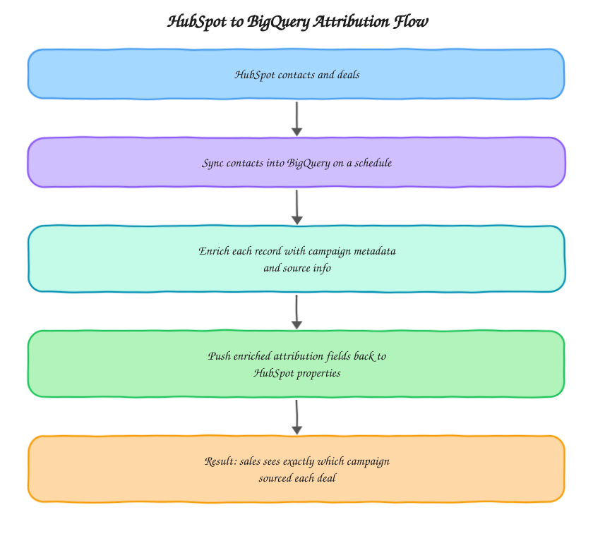

# HubSpot to BigQuery Sales Attribution

A two way sync between HubSpot and BigQuery that enriches every contact with campaign and source metadata, then pushes that enrichment back into HubSpot so sales reps see exactly which campaign sourced each deal without leaving their CRM. Built from the kind of sales attribution work I do at [motabar.builds.stuff](https://motabarbuildstuff.com/).

## The problem this solves

Marketing usually has campaign and source data sitting in GA4 or the ad platforms, and sales lives entirely in the CRM. Without a sync between them, sales has no visibility into which campaign actually produced a given deal, and marketing has no clean way to tie closed revenue back to specific campaigns without manually cross-referencing two systems. This project closes that loop in both directions, enrichment flows into BigQuery for analysis, and the enriched attribution flows back into HubSpot for sales to see directly on the contact record.

## Architecture

The sync is deliberately one directional per hop, contacts flow HubSpot to BigQuery, enrichment happens in BigQuery, and enriched fields flow back to HubSpot as custom properties. Nothing tries to reconcile changes made on both sides simultaneously, which keeps the sync logic simple and avoids the conflict resolution problems that come with true bidirectional sync.

## What's in here

* `python/hubspot_bigquery_sync.py` pulls HubSpot contacts and deals into BigQuery on a schedule, and pushes enriched campaign attribution fields back to HubSpot as custom contact properties
* `sql/enrich_contacts_with_campaign_source.sql` joins synced HubSpot contacts against GA4 and ad platform data to determine each contact's first touch campaign and source

## How it's used in practice

The sync runs on a schedule (typically daily), pulling any new or updated HubSpot contacts into BigQuery first. The enrichment query then joins those contacts against GA4 session data using email or a tracked identifier captured at form submission, determining the campaign and source that first brought that contact in. The result gets written back to HubSpot as custom properties (`campaign_source`, `first_touch_channel`, `attribution_confidence`) that show up directly on the contact record, so a sales rep opening a deal doesn't need to ask marketing where the lead came from.

## What good output looks like

The large majority of contacts should end up with a non-null `campaign_source` after enrichment. Contacts that stay unattributed are usually either offline leads (referrals, cold outreach) that never had a tracked web session, or leads where the identifier wasn't captured at form submission, worth checking `attribution_confidence` on those specifically, since a low-confidence match is often a sign the join key needs tightening rather than a genuinely untracked lead.

## Setup

1. Set up HubSpot API access with read access to contacts and deals, and write access to custom contact properties
2. Create the custom properties in HubSpot (`campaign_source`, `first_touch_channel`, `attribution_confidence`) ahead of the first sync
3. Schedule `hubspot_bigquery_sync.py` to run daily
4. Run `enrich_contacts_with_campaign_source.sql` after each sync to compute and push back the attribution fields

## Stack

Python, HubSpot API, BigQuery, GA4, SQL

## Related

* Case study: [HubSpot + BigQuery Sales Attribution](https://motabarbuildstuff.com/case-studies/hubspot-bigquery-sales-attribution/)
* Guide: [HubSpot shows Offline Sources for my contacts. Why, and how do I fix it?](https://motabarbuildstuff.com/blog/hubspot-offline-sources-fix/)
* Service: [Marketing analytics consulting](https://motabarbuildstuff.com/marketing-analytics-consultant/)

Built by [Motabar Javaid](https://motabarbuildstuff.com/about/), analytics engineer at [motabar.builds.stuff](https://motabarbuildstuff.com/).
